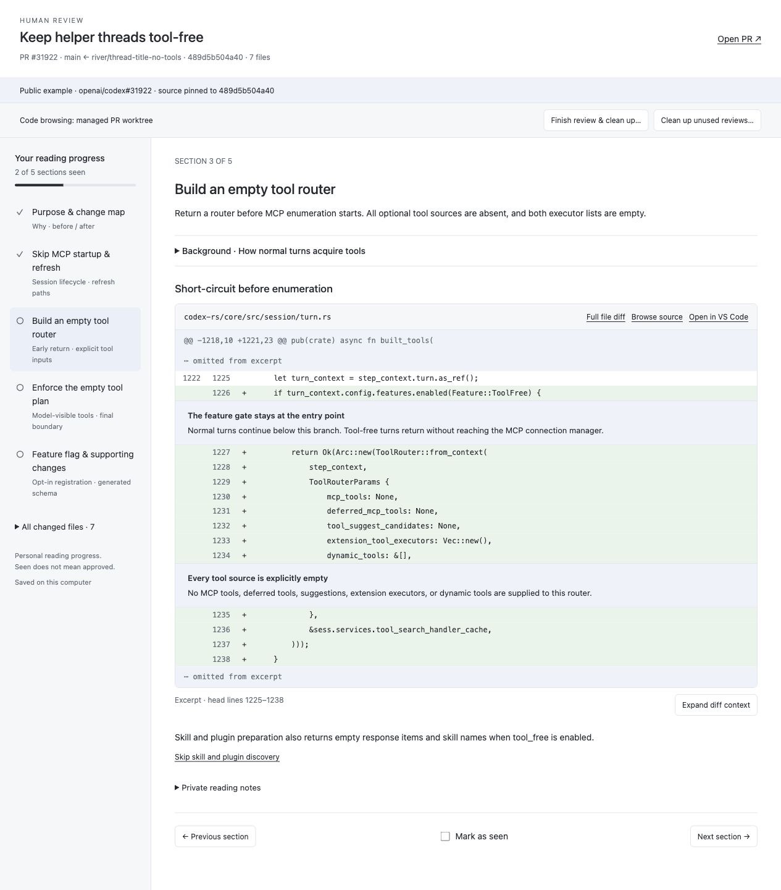

# Human Review

A Codex plugin that turns a PR, branch, or working tree into a browsable reading guide for human code review.

It explains why the code changed, maps the important changes, and presents inline annotated diffs with optional background and data-flow explanations. Full file diffs, VS Code links, reading progress, and private notes are included. Automated findings and approval judgments are outside its scope.



*Example: [openai/codex#31922](https://github.com/openai/codex/pull/31922), using public source code.*

## Usage

With the plugin enabled, open a Codex chat in the repository and ask:

```text
Use Human Review to build a review guide for:
https://github.com/OWNER/REPO/pull/123
```

You can also ask for a guide to a local branch or your working tree. Codex prepares the guide and opens a local browser viewer.

Requires Python 3, Git, and authenticated `gh` for PRs. No pip or npm dependencies are needed.

## Worktrees and saved data

Reviews live under `~/.codex/human-review/`, outside this repository. PRs reuse a clean checkout at the exact reviewed commit or create a detached review worktree. Local reviews use the existing checkout.

**Finish review & clean up** removes eligible plugin-owned worktrees while retaining the guide, notes, progress, and captured source. **Reopen code checkout** recreates a checkout. **Clean up unused reviews** previews checkouts idle for 14 days; deletion requires confirmation. Reused, edited, or active checkouts are protected.

Bazel repositories require `bazel clean --expunge --async` before worktree removal; failed cleanup keeps the checkout.

## Development

- `.codex-plugin/plugin.json`: plugin metadata.
- `skills/review-guide/`: workflow instructions and guide format.
- `scripts/`: snapshot capture, viewer server, worktree lifecycle, and tests.
- `assets/`: browser UI.

Run the tests:

```sh
python3 scripts/test_review.py
```
